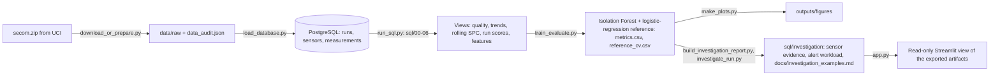
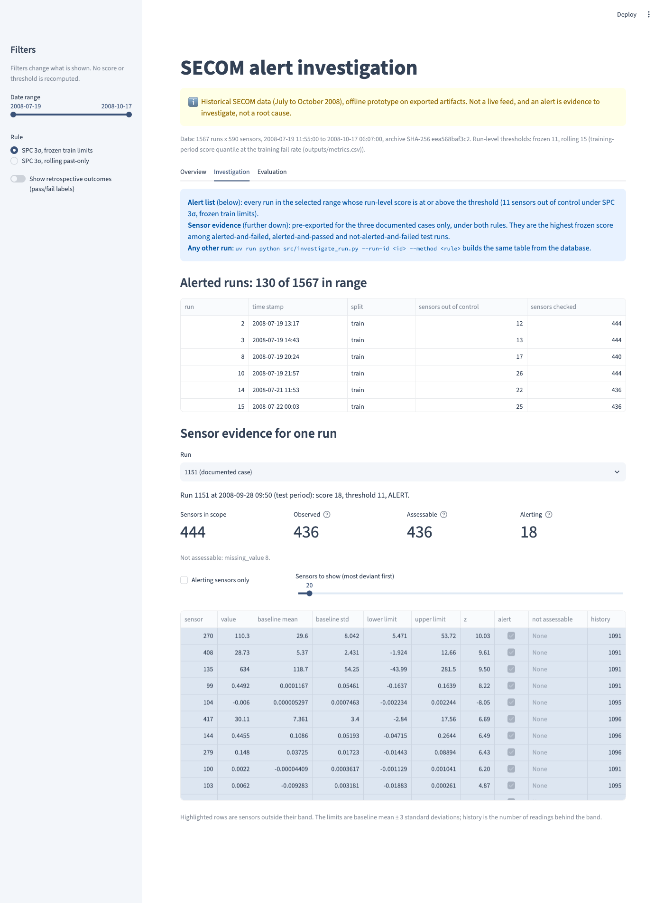
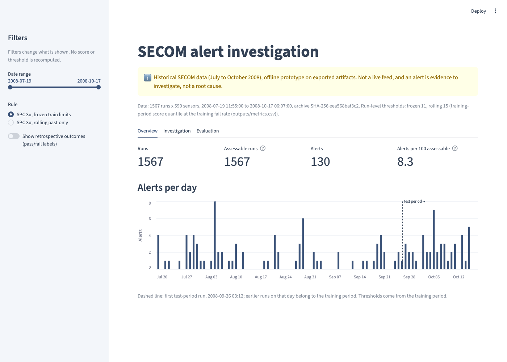

# Industrial Sensor Data Analytics & Anomaly Detection

Semiconductor process monitoring on the UCI SECOM dataset.
`Python | SQL | PostgreSQL | scikit-learn | Streamlit`

## Overview

Can sensor readings from a semiconductor production line flag the runs that later fail the in-house yield test? This project loads the SECOM data (1,567 runs × 590 sensors, 104 fails = 6.64%) into PostgreSQL and runs data-quality and statistical process control (SPC) queries in SQL. It scores each run with an Isolation Forest and a supervised reference, evaluates all of them on a chronological holdout, and traces every alert back to the sensors behind it.

**Result in one line:** on the last 30% of runs (471 runs, 26 fails), neither the frozen 3σ SPC rule (AP 0.070) nor the Isolation Forest (AP 0.062) is clearly better than random ranking (AP 0.055). A supervised logistic regression reaches 0.070 on the same holdout. With 26 positives the data cannot rank the methods, and the project reports that as it is.

This is an offline analysis of historical data (July to October 2008). It is not a live monitoring system, and a sensor anomaly here does not establish a root cause.

## Key features

- **Long-format PostgreSQL schema** (924,530 readings, missing values as explicit NULL) and seven SQL query files (ten views) for data quality, fail trends, past-only rolling 3σ SPC, run-level alert scores and model features.
- **Leak-free evaluation**: chronological 70/30 split; sensor exclusion, imputation, scaling, models, control limits and thresholds all fitted on the training period; fold-local preprocessing inside the reference's cross-validation; tests that alter test-period data and labels and check that nothing earlier moves.
- **Alert investigation in SQL**: parameterised queries and a CLI that list, for one run, every sensor's reading, baseline, limits, z-score and the reason a sensor could not be assessed. Sensor alerts are checked against the run-level score.
- **Alert workload report** per day and rule, with unassessable runs counted separately, and three documented cases.
- **Read-only Streamlit view** of the exported artifacts, tested headlessly with Streamlit's `AppTest`.
- **One command reproduces everything**: `./run_all.sh` (about 35 seconds after the first download) regenerates every file in `outputs/` and runs 31 tests.

## Architecture



## Dashboard demo

One page, three tabs, reading `outputs/` only. Filters change what is shown, never a score or a threshold; pass/fail labels appear only behind a retrospective-outcomes toggle.

**Investigation**: alerted runs in the selected range, then the sensor evidence for one run with alerting sensors highlighted. Evidence is pre-exported for three documented cases; any other run is one CLI command away.



**Overview**: alerts per day and per 100 assessable runs, with the first test-period run marked. **Evaluation**: the average-precision summary, the precision-recall curves and the paired bootstrap comparisons.



## Results and limitations

Test period: 471 runs, 26 fails, random-ranking AP = 0.0552. Intervals are 95% paired bootstrap intervals; precision and recall are at the threshold chosen on the training period (from `outputs/metrics.csv`).

| Method | Uses labels | AP | AP 95% CI | Precision | Recall |
|---|---|---|---|---|---|
| Isolation Forest | no | 0.0618 | [0.0362, 0.1182] | 0.053 | 0.115 |
| SPC 3σ, frozen train limits | no | 0.0703 | [0.0414, 0.1405] | 0.083 | 0.154 |
| SPC 3σ, rolling past-only (different protocol) | no | 0.1016 | [0.0535, 0.2134] | 0.172 | 0.192 |
| Logistic regression (reference) | training only | 0.0702 | [0.0451, 0.1166] | 0.000 | 0.000 |


- Every interval includes the random baseline, and the interval for the difference between the two primary methods includes zero. That does not prove the methods equal random ranking; it shows that 26 positives cannot separate them.
- The rolling rule updates its band with earlier test-period readings, so its higher AP is not a like-for-like win over the frozen rule.
- The fail rate falls from 22.2% in July to 2.9% in September, and 56 of 444 sensors shift level between the periods. A single chronological split cannot say how much of the drop in AP is drift and how much is sampling noise.
- SECOM does not name its sensors or document its time stamps beyond the test point, so this is a retrospective replay, not early warning, and no claim about root causes is made.

The full protocol, the paired comparisons, the training-period diagnostics and the complete list of limitations are in [docs/technical_details.md](docs/technical_details.md).

## Quick start

Requirements: Docker with Compose, and [uv](https://docs.astral.sh/uv/). Python 3.12 and all packages are pinned in `uv.lock`.

```bash
./run_all.sh                                                        # PostgreSQL in Docker, data, SQL, models, figures, report, tests
uv run streamlit run app.py                                         # read-only view of outputs/
uv run python src/investigate_run.py --run-id 1458 --method spc_frozen   # sensor evidence for one run
```

Local database credentials are in `.env.example`; the container listens on localhost only.

## Documentation

- [docs/technical_details.md](docs/technical_details.md): data audit, schema, every SQL query, evaluation protocol, full results, investigation tooling, limitations, tests.
- [docs/investigation_examples.md](docs/investigation_examples.md): three documented alert cases with their sensor evidence.
- `outputs/`: every number in this README (`metrics.csv`, `ap_differences.csv`, `sql/`, `investigation/`, `figures/`).

## Data and license

Data: McCann, M. & Johnston, A. (2008). SECOM [Dataset]. UCI Machine Learning Repository. https://doi.org/10.24432/C54305, licensed under [CC BY 4.0](https://creativecommons.org/licenses/by/4.0/). The raw files are downloaded by `src/download_or_prepare.py` and are not redistributed here.

Code: MIT License (`LICENSE`).
