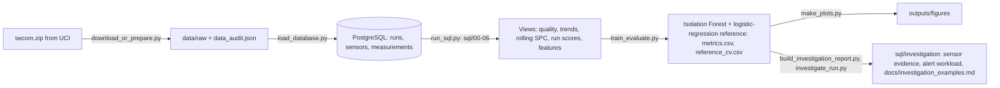
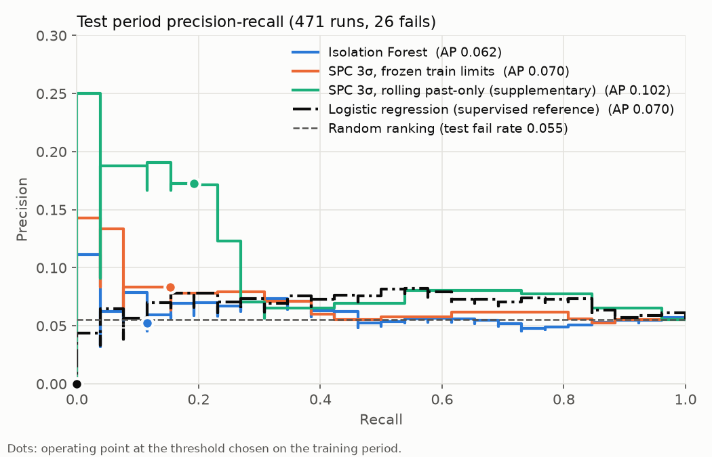
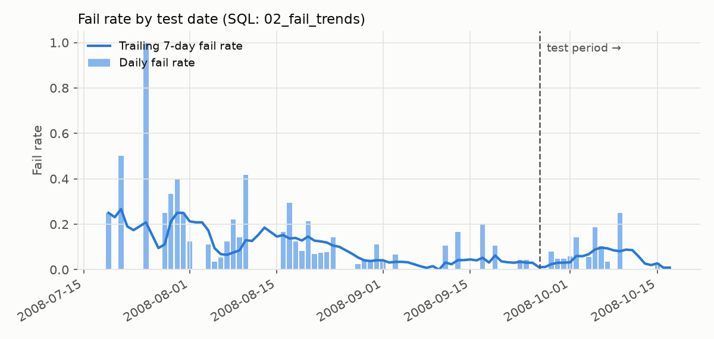

# Industrial Sensor Data Analytics & Anomaly Detection

Semiconductor process monitoring using the UCI SECOM dataset.
`Python | SQL | PostgreSQL | scikit-learn`

Can sensor readings from a semiconductor production line flag the runs that later fail the in-house yield test? This project loads the SECOM sensor data into PostgreSQL and runs data quality and statistical process control (SPC) queries in SQL. It then scores each run with an Isolation Forest, adds a supervised logistic-regression reference, and evaluates all of them on a chronological holdout.

**Result in one line:** under chronological holdout evaluation (last 30% of runs: 471 runs, 26 fails), both unsupervised anomaly scores had limited ability to identify downstream failures. Average precision is 0.070 for the frozen 3σ SPC rule and 0.062 for the Isolation Forest, against a random-ranking baseline of 0.055, and the bootstrap intervals of both include the baseline. With this sample size, the data do not support a claim that either method is clearly better than random ranking. They also do not establish that the methods are equivalent to it. A supervised logistic-regression reference, which does see training labels, reaches 0.070 on the same holdout. Section 7 has the full table.

This is an offline analysis of a historical dataset. It is not a live monitoring system, and a sensor anomaly here does not establish a root cause.

## 1. Data

**Source.** McCann, M. & Johnston, A. (2008). SECOM [Dataset]. UCI Machine Learning Repository. https://doi.org/10.24432/C54305. Licensed under [CC BY 4.0](https://creativecommons.org/licenses/by/4.0/). The raw files are not redistributed here; `src/download_or_prepare.py` downloads the archive and checks its SHA-256.

**What is in it** (measured by `src/download_or_prepare.py`, saved in `outputs/data_audit.json`):

| Item | Value |
|---|---|
| Runs (one per production entity) | 1,567 |
| Sensor columns | 590 (the UCI page says 591; the downloaded file has 590) |
| Label | `-1` = pass (1,463 runs), `1` = fail (104 runs, 6.64%) |
| Time stamps | 2008-07-19 11:55 to 2008-10-17 06:07, 86 days with runs, 18.2 runs per day on average |
| Missing readings | 41,951 cells (4.54%); every run has at least one missing reading; 538 of 590 sensors have at least one |
| Duplicate time stamps | 65 runs share a time stamp with another run; ties are broken by file order (`run_id`) |

The fail rate is not stable over time. By month it is 22.2% in July (14 of 63 runs), 9.2% in August (51 of 555), 2.9% in September (17 of 590) and 6.1% in October (22 of 359), computed from `outputs/sql/fail_trends_daily.csv`.

## 2. Pipeline



## 3. Database schema

Three tables in long format (`sql/schema.sql`):

| Table | Rows | Columns |
|---|---|---|
| `runs` | 1,567 | `run_id` (PK), `ts`, `label`, `is_fail` (generated: `label = 1`) |
| `sensors` | 590 | `sensor_id` (PK), `sensor_name` |
| `measurements` | 924,530 | `run_id` (FK), `sensor_id` (FK), `value` (NULL = missing); PK `(run_id, sensor_id)` |

Indexes: `runs (ts, run_id)` for chronological ordering and the time-based split; `measurements (sensor_id, run_id)` for per-sensor scans and joins.

**Why long format instead of a 590-column table.** Per-sensor statistics become one `GROUP BY sensor_id`. Rolling SPC becomes one window function with `PARTITION BY sensor_id` instead of 590 copies of the same expression. Missing readings are stored as explicit `NULL` rows, so the row count is fixed at 1,567 × 590. A missing rate is then a plain `count(*) FILTER (WHERE value IS NULL)`.

## 4. Setup and reproduction

Requirements: Docker with Compose, and [uv](https://docs.astral.sh/uv/). Python 3.12 and all packages are pinned in `uv.lock`.

```bash
./run_all.sh
```

This starts PostgreSQL 16.14 in Docker, downloads and loads the data, and runs the SQL, the model, the figures and the tests. Every file in `outputs/` is regenerated. Local database credentials are in `.env.example`; the container listens on localhost only.

To run a query by hand inside the container:

```bash
docker compose exec db psql -U secom -d secom -c "SELECT * FROM period_shift_summary;"
```

## 5. SQL queries

Each `sql/0*.sql` file creates one view; `04`, `05` and `06` create a second one (`frozen_limits`, `feature_export_all`, `period_shift_summary`). Later views build on earlier ones. `sensor_quality`, `frozen_limits` and `spc_run_scores` are materialized views: the first two are fixed once the training period is loaded, and the third would otherwise recompute the rolling window for every reading on every query. `src/run_sql.py` runs the files in order, which rebuilds them, and exports the small results to `outputs/sql/`.

| File | Question it answers | SQL used |
|---|---|---|
| `00_run_split.sql` | Which runs are in the training period (first 70% by time)? | `row_number()` and `count(*)` window functions, `CASE` |
| `01_sensor_quality.sql` | How complete and how variable is each sensor? Which sensors are excluded? | CTE, JOIN, aggregate `FILTER`, `count(DISTINCT)` |
| `02_fail_trends.sql` | How many runs per day, and how does the fail rate move? | CTE, `GROUP BY`, named `WINDOW` with `RANGE BETWEEN INTERVAL '6 days' PRECEDING` |
| `03_spc_rolling.sql` | Which readings fall outside a 3σ band built from that sensor's previous 50 runs? | CTE, three-table JOIN, `PARTITION BY ... ROWS BETWEEN 50 PRECEDING AND 1 PRECEDING` |
| `04_spc_run_scores.sql` | What are the frozen control limits, and how many sensors are out of control in each run (frozen and rolling)? | `frozen_limits` view, two CTEs, JOIN, aggregate `FILTER` |
| `05_feature_export.sql` | What is the model input? One row per run with sensor readings as an array (eligible sensors; all 590 for the supervised reference) | JOIN, `array_agg(... ORDER BY ...)` |
| `06_period_shift.sql` | Did sensor levels move between the training and test periods? | CTE on `frozen_limits`, self-join, `percentile_cont` for medians |

Three parameterised queries in `sql/investigation/` are run with bound parameters by `src/investigate_run.py` and `src/build_investigation_report.py` (section 8):

| File | Question it answers | SQL used |
|---|---|---|
| `run_sensor_evidence_frozen.sql` | For one run, which sensors are outside the frozen limits, by how much, and which could not be assessed? | JOIN on `frozen_limits`, `%(run_id)s` bind parameter, `ORDER BY ... NULLS LAST` |
| `run_sensor_evidence_rolling.sql` | The same question under the past-only rolling band, with the history behind each band | CTE that takes the 50 preceding runs, aggregates with `ORDER BY` inside `avg()` and `stddev_samp()`, `LEFT JOIN`, `CASE` for the unassessable reason |
| `alert_workload.sql` | How many runs per day does each rule send to an engineer, and how many of them failed? | `CROSS JOIN LATERAL (VALUES ...)` to unpivot the two rules, aggregate `FILTER`, `nullif` |

**Sensor exclusion** (`01`, decided on the training period only): 122 sensors are constant in the training period and 24 have more than 50% missing readings there. The remaining 444 sensors are used by SPC and the model. Sensors that are constant most of the time but not always are kept, because a rare deviation is what SPC is meant to catch.

**Rolling SPC** (`03`): for each sensor, the baseline mean and standard deviation come from the previous 50 runs (`ROWS BETWEEN 50 PRECEDING AND 1 PRECEDING`). The current reading and all later readings are excluded. A reading is not evaluated in three cases: it is missing, fewer than 20 of the previous 50 readings are present, or all previous readings are identical.

## 6. Evaluation protocol

**Split.** Runs are sorted by `(ts, run_id)`. The first 70% form the training period, the rest the test period.

| Period | Runs | Fails | Fail rate | Dates |
|---|---|---|---|---|
| train | 1,096 | 78 | 7.12% | 2008-07-19 11:55 to 2008-09-26 02:26 |
| test | 471 | 26 | 5.52% | 2008-09-26 03:12 to 2008-10-17 06:07 |

No two runs at the boundary share a time stamp.

**Time semantics.** The time stamp is the test point of each run (UCI). SECOM does not say when each sensor reading became available, so this is a retrospective evaluation in test-point order, not a demonstration of early warning. Runs that share a time stamp are ordered by `run_id` (file order), and the rolling band of such a run may include the other runs at the same time stamp. Both are offline replay assumptions; they are stated here because they cannot be tested.

**What is fitted on the training period only:** the sensor exclusion list, the median imputer, the scaler, the Isolation Forest, the logistic regression, the frozen 3σ limits, and every alert threshold. The unsupervised scores and the SPC limits use no labels. The supervised reference uses training-period labels, and the alert thresholds use one number from them, the training fail rate (see the threshold rule below). Test labels are used only to evaluate. Inside the reference's cross-validation, sensor eligibility, imputation and scaling are refitted on each fold's fit rows (`EligibleSensors` in `src/train_evaluate.py`, the same rule as `01_sensor_quality.sql`). Fitted on the whole training period, the Python rule keeps the same 444 sensors as the SQL view; a test checks this.

**Four scores per run**, all oriented so that higher means more anomalous:

| Score | Definition | Role |
|---|---|---|
| Isolation Forest | `-score_samples` of `IsolationForest(n_estimators=300, random_state=0)` after median imputation; no scaling, because Isolation Forest splits are scale-free | primary |
| SPC 3σ, frozen | Number of eligible sensors whose reading is outside mean ± 3σ, with mean and σ from the training period and held fixed | primary |
| SPC 3σ, rolling | Number of eligible sensors whose reading is outside the past-only rolling band of `03_spc_rolling.sql` | supplementary |
| Logistic regression | Predicted fail probability of `LogisticRegression(class_weight="balanced", max_iter=1000)` after median imputation and standardisation, fitted on training-period labels; C chosen by training-period cross-validation (below) | reference |

The two primary scores see the same information: training-period data only. The rolling score also uses earlier unlabelled readings from the test period to update its baseline (an online monitoring protocol). It is reported for completeness and not compared head to head with the Isolation Forest. The logistic regression is the only score that uses labels. It shows what a label-aware model reaches under the same split and is not a competitor to the unsupervised scores. Its inverse regularisation strength C is the value in {1, 0.1, 0.01, 0.001} with the highest mean out-of-fold AP in a 4-fold time-series cross-validation inside the training period (`outputs/reference_cv.csv`). Nothing else is searched, and no test-period data enters the choice.

**Threshold rule**, fixed before the test period was scored: for each method, the threshold is the training-period score quantile at which the training alert rate equals the training fail rate (7.12%). SPC scores are integers, so ties can make the actual alert rate differ from 7.12%; the realised rate is reported as `alert_rate`.

**Metrics.** Average precision (AP, the area under the precision-recall curve as computed by `sklearn.metrics.average_precision_score`) is the main metric because it does not depend on the threshold and because fails are rare. The random-ranking baseline for AP is the fail rate of the evaluated period. Precision, recall and the confusion matrix are reported at the threshold above. AP intervals are 95% percentile intervals from 2,000 paired bootstrap resamples of the test runs (`bootstrap_ap` in `src/train_evaluate.py`). The bootstrap resamples runs independently and ignores their time order, so it does not account for dependence between consecutive runs. Accuracy is not reported: predicting "pass" for every run already gives 93.4% (1,463 / 1,567).

## 7. Results

All numbers below are from `outputs/metrics.csv` and `outputs/ap_differences.csv`, which also hold the training-period (in-sample) rows.

**Test period (471 runs, 26 fails, random-ranking AP = 0.0552)**

| Method | AP | AP 95% CI | Alert rate | TP / FP / FN | Precision | Recall |
|---|---|---|---|---|---|---|
| Isolation Forest | 0.0618 | [0.0362, 0.1182] | 12.1% | 3 / 54 / 23 | 0.053 | 0.115 |
| SPC 3σ, frozen | 0.0703 | [0.0414, 0.1405] | 10.2% | 4 / 44 / 22 | 0.083 | 0.154 |
| SPC 3σ, rolling (supplementary) | 0.1016 | [0.0535, 0.2134] | 6.2% | 5 / 24 / 21 | 0.172 | 0.192 |
| Logistic regression (supervised reference) | 0.0702 | [0.0451, 0.1166] | 0.8% | 0 / 4 / 26 | 0.000 | 0.000 |

**Paired AP differences on the test period** (95% bootstrap intervals):

| Comparison | Difference | 95% CI |
|---|---|---|
| Isolation Forest − SPC frozen | −0.009 | [−0.048, +0.015] |
| Isolation Forest − SPC rolling | −0.040 | [−0.118, −0.004] |
| SPC frozen − SPC rolling | −0.031 | [−0.104, +0.010] |
| Isolation Forest − logistic regression | −0.008 | [−0.052, +0.048] |
| SPC frozen − logistic regression | 0.000 | [−0.045, +0.072] |
| SPC rolling − logistic regression | +0.031 | [−0.018, +0.136] |





**Reading the results.**

- The data do not show either primary method to be clearly better than random ranking on the test period: both AP intervals include the 0.0552 baseline, and the interval for their difference includes zero. An interval that includes the baseline does not prove equivalence to random ranking; it shows that 26 positives cannot separate the two.
- A direct way to read the operating points: lift = recall ÷ alert rate, which is 1 for random alerts. The Isolation Forest alerts on 12.1% of test runs and catches 11.5% of fails (lift 0.95). Frozen SPC alerts on 10.2% and catches 15.4% (lift 1.51). These lifts rest on 3 and 4 true positives, so one run more or less changes them a lot.
- The rolling SPC score has the highest AP (0.102) and its difference from the Isolation Forest excludes zero by a small margin. It also follows a different protocol (its baseline moves with the test period), so this is not evidence that SPC beats the model under equal information.
- The Isolation Forest AP drops from 0.129 on the training period (in-sample) to 0.062 on the test period. Both frozen methods alert on more test runs than their training rate (12.1% and 10.2% against about 7%). `06_period_shift.sql` describes what moved. Of the 444 eligible sensors, 56 have a test-period median more than 0.5 training standard deviations away from their training median (7 sensors more than 1). The mean per-sensor alert rate under frozen limits rises from 0.98% to 1.21%; it rises on 179 sensors and falls on 236. These figures show that some sensors shifted. They do not show that the shift causes the extra alerts.
- The supervised reference does no better. With C = 0.01, chosen by the training-period cross-validation, logistic regression reaches AP 0.661 in-sample and 0.070 on the test period. At its training-derived threshold it alerts on 0.8% of test runs and catches none of the 26 fails. In the cross-validation itself (`outputs/reference_cv.csv`), mean out-of-fold AP ranges from 0.086 (C = 1) to 0.118 (C = 0.01), against fold fail rates of 0.119, 0.046, 0.027 and 0.027; the best single fold reaches 0.204 with 6 fails. Fitting eligibility once on the whole training period instead of per fold (the approach in commit `35c4652`) changes each of these means by less than 0.001 and does not change the selected C or the test-period result. A label-aware model therefore also ranks later fails close to random on this data, both inside the training period and on the holdout. This is consistent with the reading that the sensors record little of what makes a product fail, but 26 positives do not settle it.

## 8. Alert investigation

An engineer who sees a run alert needs to know which sensors crossed their limits, by how much, what the limits were built from, and which sensors could not be assessed. The investigation queries answer that from the database; Python only binds parameters, checks consistency and formats the output.

```bash
uv run python src/investigate_run.py --run-id 1458 --method spc_frozen --top 10
uv run python src/investigate_run.py --run-id 1458 --method spc_rolling --csv run_1458_rolling.csv
```

The output starts with the run-level score, the training-derived threshold and the alert decision. Then come four nested counts: sensors in scope (444 eligible), observed (reading present), assessable (a band exists and the reading is present) and alerting. Sensors that are not assessable carry a reason: `missing_value`, `insufficient_history` (fewer than 20 of the previous 50 readings) or `flat_window`. A run with nothing assessable is reported as such, not as normal. The sum of sensor alerts must equal the run score in `spc_run_scores`; the CLI and the report builder raise if it does not. The pass/fail label is shown only with `--outcome`. Under the rolling rule the first 20 training runs have no assessable sensor, because no sensor has the 20 previous readings the band requires; under the frozen rule every run is assessable.

`src/build_investigation_report.py` writes `outputs/investigation/`. `alert_workload.csv` has one row per day, rule and period: runs, assessable runs, alerts, alerts per 100 assessable runs, and the retrospective TP/FP/FN/TN. Unassessable runs are listed separately, not counted as true negatives. `sensor_evidence.csv` holds the evidence for three example runs, and `manifest.json` records the data hash, package versions and thresholds. The totals are checked against `outputs/metrics.csv`. Test-period totals:

| Rule | Runs | Alerts | Alerts per 100 runs | TP | FP | FN | TN |
|---|---|---|---|---|---|---|---|
| SPC 3σ, frozen | 471 | 48 | 10.2 | 4 | 44 | 22 | 401 |
| SPC 3σ, rolling | 471 | 29 | 6.2 | 5 | 24 | 21 | 421 |

[`docs/investigation_examples.md`](docs/investigation_examples.md) walks through three test-period runs chosen by a fixed rule: the highest frozen score among alerted-and-failed, alerted-and-passed, and not-alerted-and-failed runs (runs 1151, 1458 and 1227). SECOM does not name its sensors, so the examples stop at which sensors deviated and by how much. They do not claim a root cause, and an alert on a passing run is not necessarily a false alarm about the process.

## 9. Limitations

- **Few positives.** The test period has 26 fails. Each true positive moves recall by 3.8 percentage points, and the AP intervals above are wide for that reason. No claim of "method A beats method B" is supported by this data.
- **Sensor anomalies and product failures do not align well here.** Both unsupervised scores rank runs by how unusual their readings are, and on this holdout that ranking had limited relation to the yield label. Three factors could explain this, and the present analysis cannot separate them: the small number of positives, the distribution shift over time, and a real gap between what the sensors record and what makes a product fail. The supervised reference (AP 0.070 on the same holdout) points to the third factor but does not settle it. The dataset's own documentation reports balanced error rates of 33.5% to 40.1% for supervised feature-selection baselines under 10-fold cross-validation (`secom.names`), so even label-aware methods find the problem hard.
- **Non-stationary data.** The monthly fail rate moves from 22.2% in July to 2.9% in September, and 56 of 444 sensors shift level between the periods. Statistics fitted on the first 70% do not describe the last 30%. A single chronological split cannot say how much of the drop in AP is drift and how much is sampling noise.
- **Threshold rule.** Equalising the training alert rate with the training fail rate is one of three defensible choices. Fixing an acceptable false-alarm rate on passing runs, or choosing a threshold on a validation period, would give different operating points; none was evaluated.
- **Undocumented extreme values.** Ten readings lie between 9,990 and 10,000 (sensor 204: 5, sensor 140: 4, sensor 90: 1), far from each sensor's typical range (sensor 140's median is 0.24). They look like placeholder codes, but `secom.names` does not say so, and they are treated as ordinary readings.
- **View recomputation.** `spc_rolling` is a plain view, so a query on it recomputes the window statistics for all 695,748 eligible readings (about 5 seconds on the development machine). `spc_run_scores` is materialized so that this happens once per `run_sql.py` run. The rolling evidence query does not read the view: it rebuilds the band for one run from its 50 preceding runs in about 10 ms. `tests/test_investigation.py` checks that its baseline, standard deviation, z-score, history count and alert flag equal the view's, value for value, on 8 runs chosen around the window boundaries. An interactive interface should read the materialized views and exported artifacts rather than `spc_rolling`.
- **Inspected holdout.** The test period was examined while the investigation tools and the supervised reference were built. Any method added later and reported on it is a retrospective extension, not a result on untouched data.
- **Scope.** Offline analysis of one historical dataset. Nothing here was validated on a production line, and alert counts are not calibrated failure probabilities.

## 10. Implemented and future work

Implemented: data audit, PostgreSQL schema and loader, seven SQL query files (ten views) plus three parameterised investigation queries, past-only rolling SPC with leakage tests, Isolation Forest with train-only preprocessing, a supervised logistic-regression reference with fold-local preprocessing and a training-period cross-validation over C, chronological holdout with AP, precision, recall, confusion matrices and bootstrap intervals, a sensor-evidence CLI, an alert-workload report, three documented cases, two figures, 24 tests (`uv run pytest`).

Not implemented: random stratified splits, expanding-window validation, PCA Hotelling T² / SPE, and any dashboard or interactive interface.

## Tests

- `tests/test_data_contract.py`: the loaded tables match the raw files, and the PK, FK and CHECK constraints reject bad rows.
- `tests/test_temporal_leakage.py`: on synthetic data run through the real `sql/` files, the rolling baseline uses previous rows only, runs with equal time stamps are ordered by `run_id`, changing test-period values leaves training-period scores and the frozen limits unchanged, flipping labels changes no score, limit or sensor evidence, and the evidence for one run keeps the full history and the same limits as the SPC views.
- `tests/test_evaluation.py`: score direction and label mapping, and training scores and thresholds do not depend on test-period features.
- `tests/test_investigation.py`: sensor alerts sum to the run score, the nested counts and unassessable reasons add up, unknown runs and methods are rejected, the Python eligibility rule matches the SQL view, and the workload totals agree with `metrics.csv`.

`test_data_contract.py` and `test_investigation.py` need the database running and loaded (the latter also needs `outputs/metrics.csv`), `test_temporal_leakage.py` needs it running, and `test_evaluation.py` needs no database. Tests that cannot reach what they need skip with a message, except under `SECOM_TESTS_REQUIRE_DB=1` (set by `run_all.sh`), where they fail instead.

## License

Code in this repository is released under the MIT License (`LICENSE`). The SECOM dataset is licensed separately under CC BY 4.0 by its authors; see section 1.
